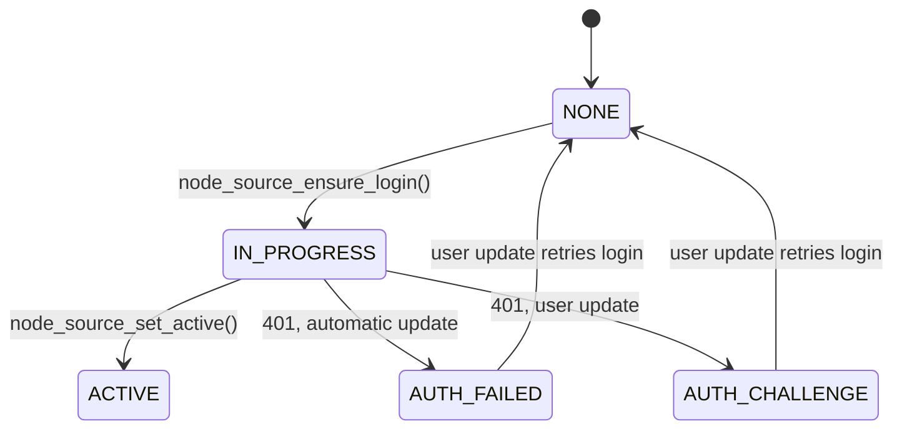
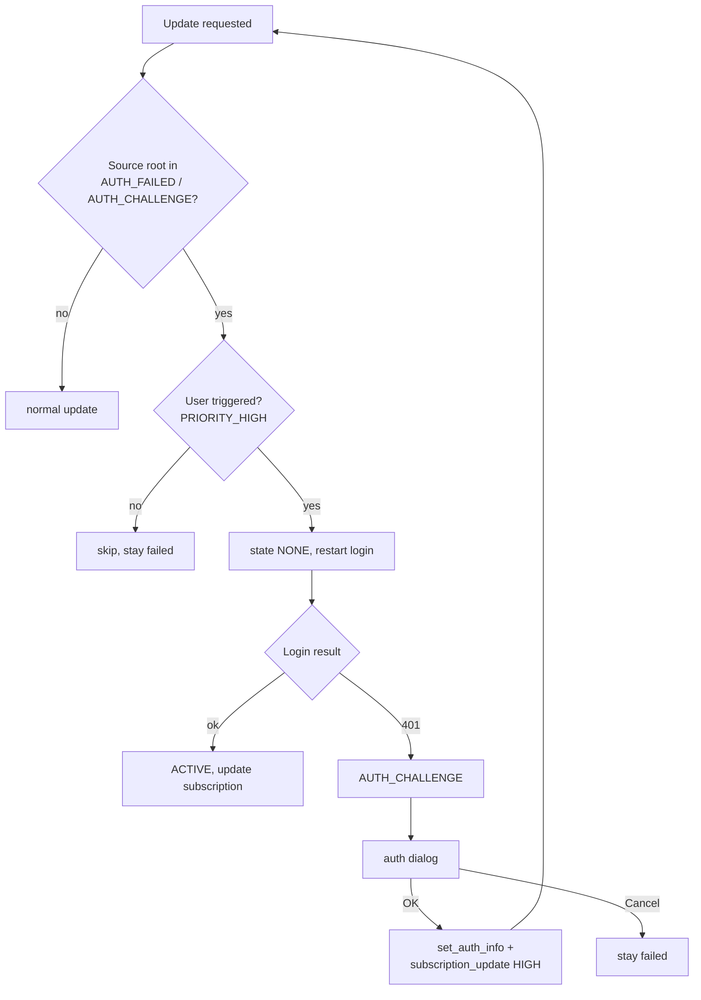

# Authentication and auth failure handling

## Concepts

- Credentials live in the subscription (`subscription->updateOptions`), set with
  `subscription_set_auth_info()`. Requests built from a subscription carry them.
- Node sources with `NODE_SOURCE_CAPABILITY_CAN_LOGIN` have a **login state**
  (`nodeSourceState`, `node->source->loginState`) on their root node.
- Plain feeds have no login state. They only have `subscription->error`.
- A source root is also a subscription (`root->subscription`), so it has both.

## Login states

| State | Value | Meaning |
|-------|-------|---------|
| `NONE` | 0 | no login tried yet |
| `IN_PROGRESS` | 1 | login running, updates are skipped |
| `ACTIVE` | 2 | logged in, updates allowed |
| `AUTH_FAILED` | 3 | login failed, no dialog shown (automatic update) |
| `AUTH_CHALLENGE` | 4 | login failed, credential dialog is shown (user update) |

- `node_source_set_auth_failed (root, challenge)` picks the failed state. Sources pass
  `job->flags & UPDATE_REQUEST_PRIORITY_HIGH` as `challenge`.
- Entering `AUTH_CHALLENGE` opens the auth dialog, `AUTH_FAILED` marks the node unavailable.

## User vs. automatic updates

- User triggered updates carry `UPDATE_REQUEST_PRIORITY_HIGH`, automatic ones do not.
- `node_source_ensure_login()` never retries a failed login for automatic updates.
  This avoids hammering the server with wrong credentials and popping up dialogs.
- A user update resets the failed state and restarts the login.
- `subscription_update()` does this for user updates on a failed source root by calling
  `node_source_update (node, flags)`. So the auth dialog only has to call
  `subscription_update (subscription, UPDATE_REQUEST_PRIORITY_HIGH)`.
- Without this, `subscription_can_be_updated()` rejects any update while the source
  is not `ACTIVE`.

## Plain feeds

- A 401 in `subscription_process_update_result()` sets `FETCH_ERROR_AUTH`, marks the
  node unavailable and calls `auth_dialog_new()`.
- `subscription->activeAuth` ensures only one dialog per subscription is open.
- Known gap: this opens the dialog for automatic updates too.
  The same applies to a 401 on the source index fetch of an already logged in source.

## Showing the error

- Set the error data **before** changing the login state, as the state change
  triggers the node info view update.
- Fetch errors: `subscription->error` (`FETCH_ERROR_AUTH` / `FETCH_ERROR_NET`),
  `httpErrorCode`, `httpError`. WebDAV flows record these in `webdav_flow_set_error()`
  and reset them in `webdav_flow_clear_error()` after a successful login.
- `resources/node.xml.in` renders the "Account login failed" hint for login
  states 3 and 4 and the fetch error details for `node.error`.

## WebDAV specifics

- There is no login request. Basic auth is added to every request
  (`webdav_request_set_basic_auth()`), the login is the first bootstrap request (MKCOL).
- `webdav_source_login()` passes the update flags to the bootstrap flow. So a user
  triggered login ends in `AUTH_CHALLENGE` (dialog), an automatic one in `AUTH_FAILED`.
- A 401 in any flow step calls `webdav_flow_set_error()` and then
  `node_source_set_auth_failed()`.
- Other bootstrap failures while logging in (MKCOL/index/PUT errors) also end in
  `AUTH_FAILED`, with the HTTP error shown as details.

