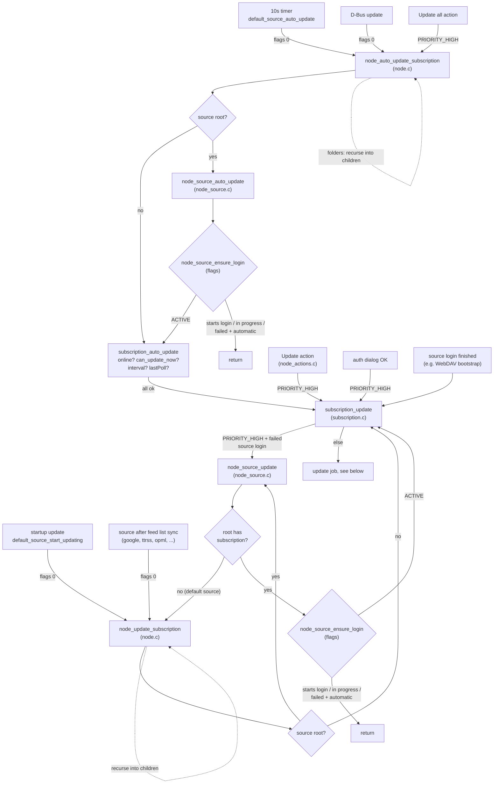
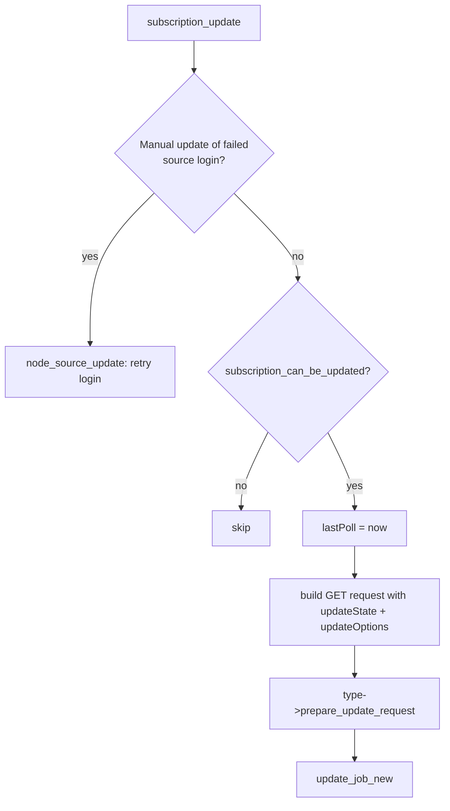
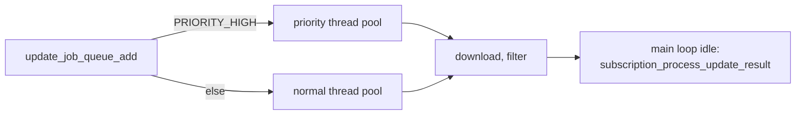

# Subscription updates

## Overview

- A subscription (`subscription.c`) owns its update: it builds the request, queues a job
  and processes the result. Node sources hook in through `subscriptionType`
  (`prepare_update_request()` / `process_update_result()`).
- Updates are either **automatic** (timer, startup) or **manual** (user action).
  Manual updates carry `UPDATE_REQUEST_PRIORITY_HIGH` in their `updateFlags`.
- Intervals are in minutes. The last poll time is `subscription->updateState->lastPoll`.

## Automatic updates

- `default_source` runs a timer every 10 s. While online it calls
  `node_auto_update_subscription()` for all children, recursively, with flags 0.
- the `default_source` is the root source and responsible to trigger the update of all 
  children (feeds, folders, node sources...)
- node source updating is trigger by `node_source_auto_update()`, which makes sure 
  login is done first (see `auth.md`). Plain feeds go to `subscription_auto_update()`.
- `subscription_auto_update()` skips the update if:
  - the network is offline,
  - `subscription_can_update_now()` fails (feed specified minimum interval not over),
  - the effective interval is 0 (auto update disabled),
  - `lastPoll + interval` is still in the future.
- Otherwise it calls `subscription_update (subscription, flags)`.
- At startup `default_source_start_updating()` optionally updates everything once
  (preference `startup-feed-action` = 0) using `node_update_subscription()`.
  This ignores intervals but still honors `subscription_can_be_updated()`.

## Effective update interval

- Three layers: feed given minimum (`ttl`, `sy:updateInterval`, `Cache-Control`),
  the user's per subscription interval and the global default (`default-update-interval`).
- User interval -2 (never) or 0 disables automatic updates, -1 uses the global default.
- Result is `max(feed minimum, user or global interval)`.

## Manual updates

- **Update** on the selected node (`node_actions.c`): checks that Liferea is online, then
  for each node of the subtree:
  - `subscription_can_update_now()` ok: `subscription_update (..., PRIORITY_HIGH)`.
  - Too early: only the explicitly selected node offers a "force update" dialog.
    Children of a folder are skipped silently.
  - Faulty subscriptions (`FETCH_ERROR_NET` / `FETCH_ERROR_AUTH`) can always be updated manually.
- **Update all** (`shell_actions.c`): `node_auto_update_subscription()` with `PRIORITY_HIGH`,
  so it still applies the interval checks of `subscription_auto_update()`.
- A manual update overrides "never update automatically" (-2), a failed source login
  is retried (see `auth.md`) and the user gets toasts for refused updates.

## Call flow

- `node_auto_update_subscription()` and `subscription_auto_update()` check intervals,
  `node_update_subscription()` does not. Both end in `subscription_update()`, which
  still applies `subscription_can_be_updated()`.
- `node_source_auto_update()` uses the flags only for the login. The root's own
  update then runs with flags 0.
- `node_auto_update_subscription()` does **not** descend into the children of a source root.
  The source updates its children itself once its feed list is synced: WebDAV with
  `node_auto_update_subscription()` (intervals apply), the others with
  `node_update_subscription()` (always).
- `node_source_ensure_login()` returning FALSE means "no update now". A started login
  continues the update when it finishes, a failed login only retries on manual updates.
- `node_source_update()` and `subscription_update()` call each other only for a failed
  login, where the login restart ends the recursion.

## subscription_update()

- `subscription_can_be_updated()` refuses: update already running, source not logged in,
  discontinued (410), never-update (-2, unless manual), no source, invalid URI.
- `lastPoll` is reset when scheduling, not when finishing. A failing update is not retried
  before the next interval.
- The request carries the conditional headers from `updateState` (ETag, Last-Modified).

## Job execution and result

- Manual updates use a separate thread pool, so they are not stuck behind a long queue of
  automatic updates.
- Results are processed in the main loop (database access).
- Multi step operations (e.g. WebDAV) are "flows": the callback returns FALSE to reschedule
  the same job with a modified request.
- `subscription_process_update_result()`:
  - 301/308 updates the source URL, 304 just marks the node available,
  - HTTP >= 400, no data or update/filter errors set `subscription->error` and mark the
    node unavailable (401 additionally asks for credentials),
  - 410 marks the subscription discontinued,
  - otherwise `type->process_update_result()` parses the data and the favicon is
    refreshed monthly.
- Error details (`httpError`, `updateError`, `filterError`) are stored for the node info view.
- On HTTP < 400 the cache information (max age, TTL, ETag, ...) is copied to `updateState`.

## Where to look

- `subscription.c`: update logic, intervals, error handling.
- `node.c`, `node_source.c`: recursion over the feed list and source login handling.
- `update_job.c`, `update_job_queue.c`: job and thread pool handling.
- `tests/subscription.c`: update gating test cases.
